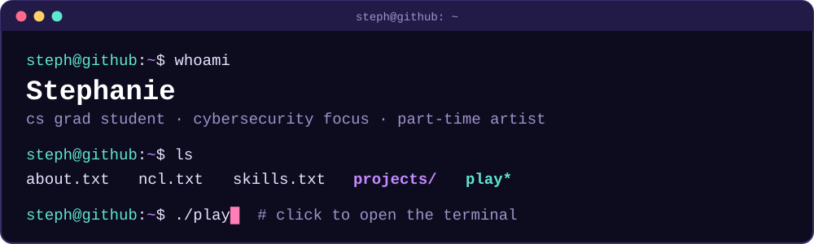
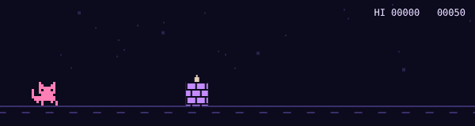

  

  

⌨️ That terminal actually works. <a href="https://stefinator04.github.io/stefinator04/">Click it</a>, poke around, then run <code>./play</code>.

## 👋 Hi, I'm Stephanie

I'm a first-year master's student in Computer Science with a cybersecurity focus. These days most of my brain cells go to security: competition challenges, digging through logs, and figuring out how things break (so I can help keep them from breaking).

- 🔐 **Right now:** cyber competitions, hands-on labs, and a lot of `grep`
- 🎨 **Side quest:** sneaking a little art into my code whenever I can get away with it
- 🚧 **Coming soon:** newer projects are on their way, so this page is still under construction
- ⚡ **Fun fact:** no, I will not be explaining the username

## 🛡️ Cyber Competitions

**National Cyber League (NCL), Fall 2026**

| Game | Rank | Highlights |
| :-- | :-- | :-- |
| 👤 Individual | **Top 26%** (1,532 of 5,959) | 95% accuracy, no hints · full points on easy/medium Log Analysis |
| 👥 Team | **Top 15%** (454 of 3,041 teams) | 89% accuracy, no hints · 97% completion in OSINT |

## 🧰 Things I Use Regularly

  

## 🔧 Things I Tinker With

  

  
  
  
  

## 🗂️ Earlier Work

| Project | What it is | Built with |
| :-- | :-- | :-- |
| [Ultimate Hangman](https://github.com/stefinator04/Python-Final-Project) | Hangman, but upgraded (group project) | Python |
| [MadLibs Reimagined](https://github.com/stefinator04/C-CPP-Group-Final-Project) | MadLibs with genres, a word bank, and story editing (group project) | C/C++ |
| [Board Game BST](https://github.com/stefinator04/Data-Structure-Final-Project) | Organizes board games by release year with binary search trees | C++ |
| [Expense Tracker](https://github.com/stefinator04/Expense-Tracker-Project) | Full-stack expense tracker built for AWS deployment | Flask, PostgreSQL, Bootstrap |

> 🌱 Newer and bigger projects are on the way. Check back soon!

## 📊 GitHub Stats

  
  

## 🤝 Connect

  

